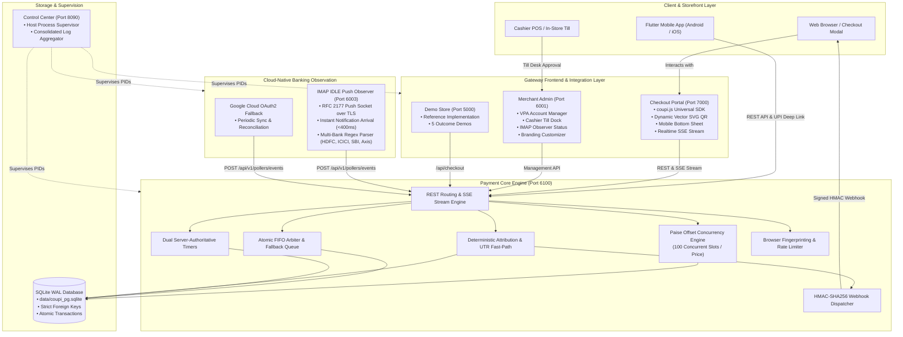
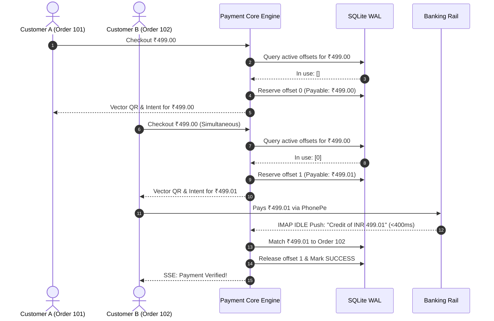
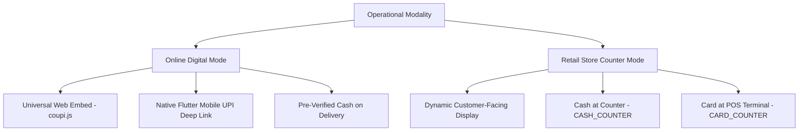

# ARCHITECTURE.md — Canonical System Architecture & Engineering Blueprint

> **COUPI PG V2**  
> *Sovereign • Self-Hosted • Zero-Fee • Cloud-Native UPI Payment Gateway Suite*  
> **Architecture Reference:** Production Specification V2  
> **Runtime Target:** Node.js `>= 20.0.0` (ESM Native) • SQLite WAL / PostgreSQL • RFC 2177 IMAP IDLE Push  
> **Successor Status:** 100% Cloud-Native Successor to Legacy `YouPI-PG` (Zero Android Phone APKs, Zero Web Scraping, 100x Concurrency)

---

## 1. Executive Summary & Mission Statement

**COUPI PG V2** is a sovereign, self-hosted, white-label UPI and multi-modal payment gateway engineered for modern digital businesses, merchants, platforms, and mobile apps in India.

### The Problem in Indian Digital Payments
Traditional Indian payment aggregators (Razorpay, Cashfree, PayU, Paytm) impose:
1. **Aggressive Fees:** 2.0% to 3.0% + 18% GST per transaction, extracting lakhs in operational margin.
2. **Delayed Settlements:** T+2 to T+3 business day settlement cycles that throttle cash flow.
3. **Arbitrary Account Freezes:** Unilateral merchant fund withholding and opaque KYC compliance holds.
4. **Hardware Fragility of Early P2P Hacks:** Prior hobbyist tools (like legacy `YouPI-PG`) attempted P2P UPI by keeping physical Android smartphones plugged into chargers 24/7 or running brittle Puppeteer scripts to scrape Google Messages Web. These failed in production due to Android battery bloat, Wi-Fi drops, OS foreground service kills, and a crippling single-user FIFO queue.

### The COUPI PG V2 Solution
COUPI PG V2 delivers enterprise-grade sovereign infrastructure without intermediaries or physical phone hardware:
- **0% Transaction Fees Forever:** Payments settle directly from the customer's UPI app into the merchant's bank account over national NPCI rails.
- **Sub-Second Direct Settlement:** Zero settlement delay; funds immediately reflect in merchant liquid balance.
- **100% Cloud-Native Banking Observation:** Utilizes standard RFC 2177 IMAP IDLE push sockets over TLS. Incoming bank credit notification emails (from HDFC, ICICI, SBI, Axis, Kotak, PNB, Canara, etc.) are ingested and parsed in less than 400ms directly inside cloud containers (Render, Railway, AWS, Docker).
- **Paise Offset Concurrency Engine:** Eliminates the single-user queue bottleneck of legacy systems by dynamically assigning fractional sub-rupee offsets (₹0.00 to ₹0.99) to concurrent sessions on identical base amounts, supporting up to 100 simultaneous checkouts per price point.
- **Cross-Platform Integration:** First-class support for universal one-script Web checkouts (`coupi.js`), React/Next.js/Vue, Flutter Android/iOS native UPI intent deep linking, and cashier till counter modes.

---

## 2. Core Architectural Invariants

Every subsystem in COUPI PG V2 strictly enforces eight mathematical and operational invariants:

### Invariant 1 — Deterministic Amount Attribution
Payment attribution enforces a strict mathematical equality:
$$\text{expected\_amount} == \text{observed\_amount}$$
The system never uses fuzzy matching, probabilistic guessing, or unverified claims. A payment session transitions to `SUCCESS` if and only if an observed banking credit exactly matches the assigned amount on the designated receiving account, or matches a cryptographically validated 12-digit bank reference (UTR).

### Invariant 2 — Non-Blocking Paise Offset Concurrency
Because P2P UPI transfers do not carry arbitrary merchant order IDs in standard bank notification alerts, identical simultaneous payments on a single VPA require attribution disambiguation.
- **The Mechanism:** When multiple customers initiate checkout for the same base amount (e.g., ₹499.00), the **Paise Offset Engine** assigns unique sub-rupee offsets:
  - Customer 1: ₹499.00
  - Customer 2: ₹499.01
  - Customer 3: ₹499.02
- **Capacity:** Supports up to 100 simultaneous concurrent payments per base price point.
- **Non-Blocking Flow:** Customers are never blocked or forced to wait in a 5-minute queue. In the rare event that all 100 offsets for a specific base amount are occupied simultaneously, the system gracefully falls back to an atomic database FIFO queue with real-time SSE promotion.

### Invariant 3 — Server-Authoritative Decoupled Dual Timers
Timing is governed exclusively by the backend state machine, not client-side clocks:
1. **5-Minute Payment Window (`ACTIVE`):** Countdown for the customer to scan the QR code or approve the UPI intent. Preserved across browser refreshes, app backgrounding, and server restarts.
2. **30-Second Verification Window (`PROCESSING`):** Triggered when the customer taps *"PAYMENT DONE — VERIFY"*. Decoupled from the 5-minute payment timer to perform high-frequency observer polling.

### Invariant 4 — Pure Vector SVG QR Code Engine
Generates ISO/IEC 18004 compliant vector SVG QR codes dynamically for standard UPI URIs:
$$\text{upi://pay?pa=}\langle\text{vpa}\rangle\text{\&pn=}\langle\text{name}\rangle\text{\&am=}\langle\text{amount}\rangle\text{\&cu=INR\&tn=}\langle\text{orderId}\rangle$$
- Zero reliance on external Google Charts or third-party image generation APIs.
- Sub-millisecond mathematical vector generation that renders crisply across mobile and desktop displays.

### Invariant 5 — Integer Minor Units (Paise) Arithmetic
All financial calculations, database schemas, and API payloads represent money strictly as 64-bit integer minor units (**Paise**):
- ₹1.00 = `100` paise | ₹499.03 = `49903` paise.
- Zero floating-point representation (`0.1 + 0.2` rounding drift is mathematically prevented).

### Invariant 6 — Cloud-Native RFC 2177 IMAP IDLE Push Invariant
Bank notification ingestion is completely decoupled from cellular hardware:
- Maintains an open, persistent TLS socket with the merchant's alert inbox (Gmail, Outlook, custom bank email domains).
- Uses the IMAP `IDLE` command to receive immediate push notifications from mail servers upon email delivery (<400ms latency).
- Zero polling intervals, zero battery drain, and zero SMS scrapers.

### Invariant 7 — Pure Source & SQLite WAL Architecture
The active production persistence layer uses Node.js native `node:sqlite` (`DatabaseSync`) operating in Write-Ahead Logging (`WAL`) mode with foreign key constraints enabled (`PRAGMA foreign_keys = ON; PRAGMA busy_timeout = 5000;`).
- Zero external database daemon dependencies required for standard installations.
- Atomic ACID transactions (`BEGIN IMMEDIATE` / `COMMIT`).

### Invariant 8 — Zero-Config Self-Healing Provisioning
On startup, COUPI PG V2 guarantees self-healing database provisioning:
- Detects whether `data/coupi_pg.sqlite` and core tables exist.
- If missing or blank, creates the parent directory and applies schema DDL and baseline seeds idempotently before binding HTTP ports.
- Prevents runtime crash states and simplifies cloud container deployment.

---

## 3. High-Level System Architecture



---

## 4. Subsystem Deep-Dive

### 4.1 Paise Offset Concurrency Engine
The Paise Offset Engine replaces the legacy single-slot FIFO queue bottleneck with non-blocking concurrent allocation.



#### Offset Allocation Implementation (`packages/core/src/offset-engine.js`)
```javascript
export class PaiseOffsetEngine {
  constructor(db, options = {}) {
    this.db = db;
    this.maxOffsetPaise = options.maxOffsetPaise ?? 99; // 0 to 99 paise
    this.windowMinutes = options.windowMinutes ?? 5;
  }

  allocateOffset(receivingAccountId, baseAmountPaise) {
    const activeOffsets = this.getActiveOffsets(receivingAccountId, baseAmountPaise);
    for (let offset = 0; offset <= this.maxOffsetPaise; offset++) {
      if (!activeOffsets.has(offset)) {
        return {
          allocatedOffsetPaise: offset,
          payableAmountPaise: baseAmountPaise + offset,
          payableAmountRupees: ((baseAmountPaise + offset) / 100).toFixed(2)
        };
      }
    }
    return null; // All 100 slots occupied; fall back to FIFO queue
  }
}
```

---

### 4.2 Cloud-Native Banking Observation Engine
Bank credit detection operates entirely within cloud server instances via RFC 2177 IMAP IDLE push sockets.

| Channel | Protocol | Latency | Infrastructure Required |
| :--- | :--- | :--- | :--- |
| **IMAP IDLE Push** | Persistent TLS Socket (RFC 2177) | **< 400ms** | Standard cloud container (0 hardware). Supported by Gmail, Outlook, Yahoo, and corporate bank email servers. |
| **OAuth2 Sync** | Google Cloud REST API | ~5s | Cloud API credentials; used for historical reconciliation. |
| **UTR Fast-Path** | Direct HTTP POST `/api/v1/sessions/:id/utr` | **Instant** | Customer pastes 12-digit UTR from UPI app receipt; backend matches observation bank reference. |

#### Bank Alert Parsing
Incoming bank alert emails are parsed by regular expression extractors covering all major Indian retail and corporate banking formats:
- **State Bank of India (SBI):** `SBI UPI: Your a/c no. XX1234 credited by Rs.(?<amount>[\d,.]+) on (?<date>[^.]+) by (?<vpa>[^\s]+) \(Ref no (?<utr>\d+)\)`
- **HDFC Bank:** `credited with Rs (?<amount>[\d,.]+) towards UPI debit.*Ref (?<utr>\d+)`
- **ICICI Bank:** `A/C \S+ credited for Rs (?<amount>[\d,.]+) on .*UPI:(?<utr>\d+)`
- **Axis Bank:** `Credited INR (?<amount>[\d,.]+) by UPI.*Ref:(?<utr>\d+)`
- **Kotak Mahindra Bank:** `credited by Rs (?<amount>[\d,.]+) via UPI.*Ref no (?<utr>\d+)`

---

### 4.3 Multi-Modal Operational Channels



1. **Online Digital Mode:**
   - Serves dynamic Vector QR codes on desktop.
   - Triggers native UPI deep links (`upi://pay?...`) on Android and iOS devices.
   - Provides optional WhatsApp buyer identity verification.
2. **Retail Store Counter Mode:**
   - Designed for in-store checkout counters and POS points.
   - Supports cash at till (`CASH_COUNTER`) and card swipe (`CARD_COUNTER`).
   - Cashier panel in Merchant Admin displays pending counter requests and approves them with a single click, instantly updating the customer's display via SSE.

---

### 4.4 Universal Merchant Web Integration (`coupi.js`)

Merchants integrate via a single declarative script:

```html
<script src="https://pay.yourdomain.com/coupi.js" data-coupi-key="MERCHANT_PUBLIC_KEY"></script>

<button data-coupi-pay
        data-order-id="ORD-1001"
        data-amount="499.00"
        data-currency="INR">
  Pay ₹499 with UPI
</button>
```

#### Cryptographic Webhook Contract
When payment succeeds, the gateway delivers a signed server-to-server webhook:
- **Header:** `X-Gateway-Signature: sha256=<hex_hash>`
- **Algorithm:** `HMAC-SHA256(raw_unparsed_request_body, merchant_webhook_secret)`
- **Verification Rule:** Merchandising servers must compute the HMAC directly over raw request bytes and verify using constant-time comparison (`crypto.timingSafeEqual`).

---

## 5. Network Topology & Port Bindings

| Service | Port | Entrypoint | Health Route | Primary Purpose |
| :--- | :---: | :--- | :--- | :--- |
| **Payment Core API** | `6100` | `apps/payment-api/src/index.js` | `GET /health` | State machine, atomic DB transactions, REST API, SSE streams, Paise Offset Engine |
| **Checkout Portal** | `7000` | `apps/checkout-portal/src/index.js` | `GET /health` | Customer iframe checkout, dynamic Vector QR, `coupi.js` SDK bundle |
| **Merchant Admin** | `6001` | `apps/merchant-admin/src/index.js` | `GET /health` | Admin dashboard, cashier till desk, IMAP observer management, branding |
| **Showcase Demo Store** | `5000` | `apps/coin-wallet-store/src/index.js` | `GET /health` | Reference merchant store, 5 outcome pages showcase, SDK testbed |
| **IMAP / Gmail Observer**| `6003` | `apps/gmail-observer/src/index.js` | `GET /health` | RFC 2177 IMAP IDLE push observer & Google Cloud OAuth2 sync |
| **Control Center** | `8090` | `apps/control-center/src/index.js` | `GET /health` | Local process supervisor for starting, stopping, and logging all 5 services |

---

## 6. Persistence & Schema Architecture

All runtime state is stored in `data/coupi_pg.sqlite` with strict foreign keys and Write-Ahead Logging:

```text
data/coupi_pg.sqlite
├── merchants (id, business_name, api_key, webhook_secret, branding [JSON])
├── payment_receiving_accounts (id, merchant_id, vpa, account_name, is_slot_busy, daily_limit_paise)
├── customers (id, mobile_number, name, email, risk_tier, is_banned, created_at)
├── customer_sessions (token, customer_id, expires_at, user_agent, ip_address)
├── payment_sessions (id, merchant_id, customer_id, receiving_account_id, base_amount_paise, offset_paise, amount_paise, status, queue_position, expires_at, utr)
├── observations (id, source, raw_text, parsed_amount_paise, parsed_utr, receiving_account_id, cluster_hash)
└── audit_logs (id, session_id, event_type, details [JSON], created_at)
```

---

## 7. Scaling Roadmap & Architectural Horizons

| Phase | Daily Scale | Architecture | Verification Source | Infrastructure Cost |
| :--- | :--- | :--- | :--- | :--- |
| **Phase 1: CouPI PG Cloud Engine** *(Current)* | 0 – 1,000 orders/day | Single/Multi-VPA + Paise Offset Engine (₹0.00 – ₹0.99) | RFC 2177 IMAP IDLE Push Email (<400ms) + UTR Fast-Path | ₹0 / Free Tier (Render / Railway / VPS) |
| **Phase 2: Bank Smart Collect / Virtual Accounts** | 1,000 – 100,000+ orders/day | Dynamic Virtual Accounts / Unique Virtual VPAs per customer (e.g. ICICI Smart Collect / Yes Bank API) | Realtime Bank Webhook APIs | ₹0 gateway cut, nominal bank corporate account fee |
| **Phase 3: Hybrid Routing** | Enterprise | Smart router directing small transactions via P2P zero-fee rails and large transactions via Bank Smart Collect | Multi-observer mesh + Direct Banking Webhooks | Sub-0.1% effective blend |
